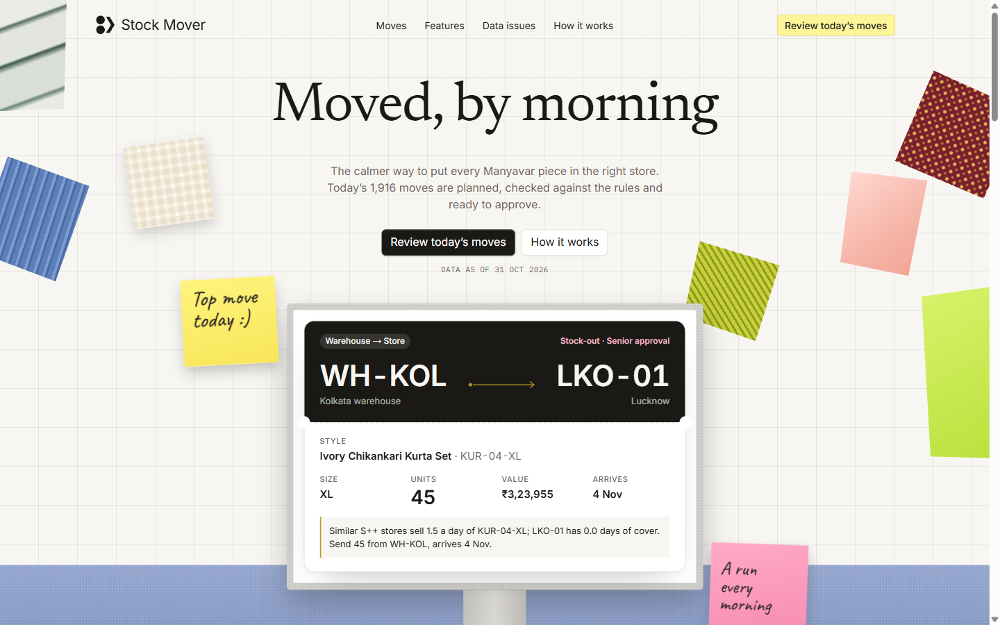
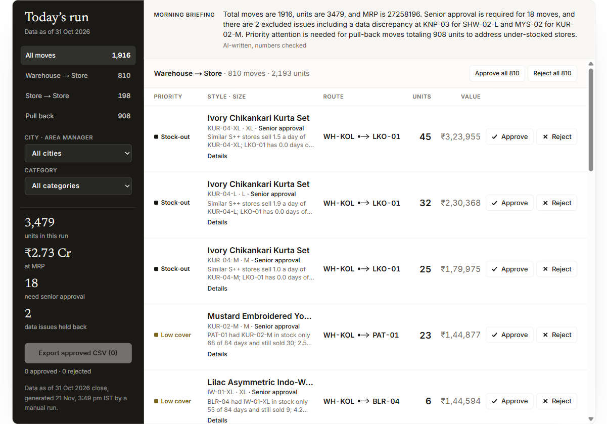
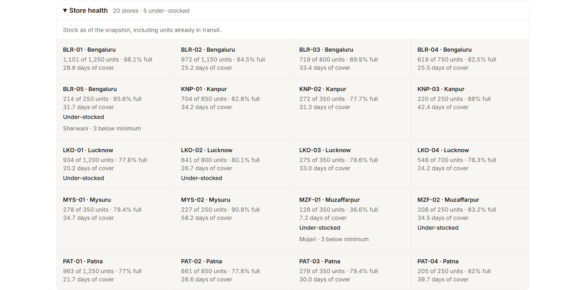
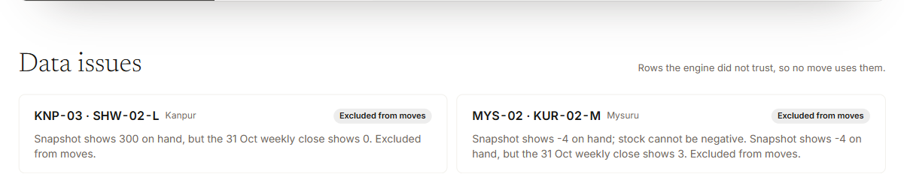
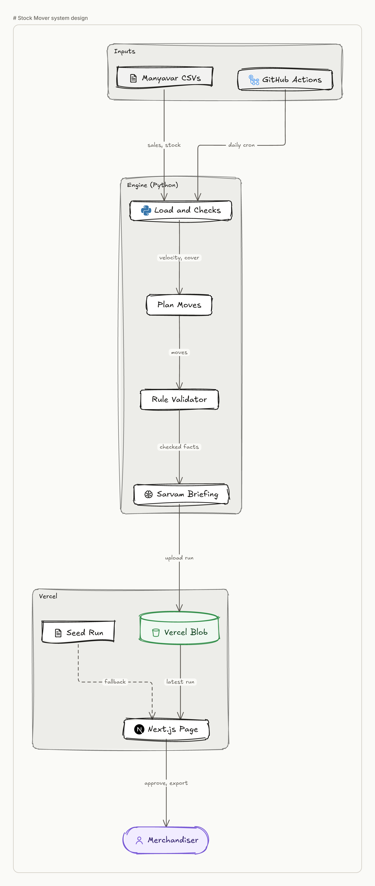

# Stock Mover

> Right stock. Right store. Right size.

**Every morning, Stock Mover turns Manyavar's sales and stock data into a ready-to-approve list of stock moves, each with a one-line reason and an independent rule check.**

- **Live app (no sign-in):** https://stock-mover.vercel.app
- **Demo video (1 min 24 s):** https://youtu.be/ZKTUJoFybTg
- Built for **Vibe Coders Hackathon Edition 3** (Calcutta AI Club, 21 Nov 2026) on the **Manyavar "Stock Mover"** statement (Vedant Fashions Limited). All code was written on the day, after 11:00 am.



## The problem

Stock sits in the wrong place every day. A best-selling kurta is out of stock in the flagship while a small store holds the same style for months. A new style looks like a flop only because the store that would sell it never got any. Working this out by hand across 20 stores, a warehouse and 385 SKUs, under rules for display minimums, capacity and protected flagship styles, takes a merchandiser hours.

## Who it is for

A **Manyavar merchandiser** who approves stock movements each morning. They need a list they can trust and approve in ten minutes, where every move makes sense in one line. **Area managers** filter the same list to their city.

## What it does

Open the live app and you get today's run:

- **Three groups of moves** (1,916 in today's run): warehouse → store (810), store → store (198), and pull back of ageing or excess stock (908).
- **A one-line reason for every move**, for example: *"Similar S++ stores sell 1.5 a day of KUR-04-XL; LKO-01 has 0.0 days of cover. Send 45 from WH-KOL, arrives 4 Nov."* Expand a move to see velocity, days in stock, cover before and after, and season lift.
- **Approve or reject** each move or a whole group, then **export the approved list as CSV**. Approvals stay after a reload (saved in the browser).
- **Rule check:** 10 rules checked independently over the final list, 0 broken.
- **Needs senior approval** tag on moves worth over Rs 1,00,000 at MRP (18 today).
- **Data issues panel:** numbers that can't be right are flagged and left out, not silently fixed.
- **Store health strip:** fill vs capacity, days of cover and min-display gaps for all 20 stores.
- **Morning briefing** written by an LLM (Sarvam) from the engine's numbers. **Every number in it is checked** against the facts; if one doesn't match, the engine retries once and then uses a template.
- **Runs on its own:** a GitHub Actions job runs at 06:00 IST every day, publishes the run to Vercel Blob, and the page picks it up within a minute. It never commits to git.





## What it found in the data

| Problem in the data | What Stock Mover does |
|---|---|
| KNP-03 shows 300 units of SHW-02-L, but weekly stock says 0 for 12 weeks | Flagged as a data issue and excluded, so 300 sherwanis are not moved and KNP-03 is not treated as over capacity |
| MYS-02 shows -4 units of KUR-02-M | Flagged and excluded |
| New style KUR-04 (Ivory Chikankari) looks slow at LKO-01, Lucknow, the home of chikankari | It was in stock only 14 of 84 days. Velocity is per day *in stock*, so "zero sales" is not read as "slow"; LKO-01 gets KUR-04 first |
| Hero style KUR-01: 1,748 sold in 90 days, 50 units in the warehouse | Fair-share allocation one unit at a time to the stores with the lowest projected cover |
| MZF-01 sells the most of any A store but is 37% full and below the Mojari display minimum | Topped up from the warehouse |
| BLR-05 opened on 10 Oct, too little history | Uses the velocity of similar stores until it has its own |
| Ageing fashion stock (JKT-08, IW-08 and others with 500+ days of cover) | Moved to the store that still sells it, else pulled back to the warehouse |
| Wedding season starts 20 Nov; last year Oct–Nov sold about 3× September | Per-zone season lift from last year's same weeks, capped at 1.0 to 3.0 |



## How it works

<p align="center">
  
</p>

1. **Load and check:** all 17 CSVs load as text with typed conversions; negative stock and snapshot vs weekly mismatches are flagged.
2. **Demand:** velocity per day in stock over 84 days; peer velocity for thin history; per-zone season lift; forecast and days of cover per store and SKU.
3. **Plan moves:** targets are lead time + 30 days of cover with a min-display floor. Warehouse stock goes out one unit at a time to the lowest projected cover, net of in-transit stock, within capacity. Store-to-store donors keep 30 days of cover and their display minimums, and S++ protected styles never leave.
4. **Validate:** an independent validator re-checks every rule over the final list. A run that breaks a rule is never published.
5. **Brief:** Sarvam writes the briefing from a facts JSON; every number in the text must appear in the facts.
6. **Publish:** the daily workflow uploads the run to Vercel Blob; the page reads it, checks it against the schema with Zod, and falls back to the committed seed run if anything is wrong.

## Run it locally

Needs Python 3.12 with [uv](https://docs.astral.sh/uv/), Node 22 and pnpm.

```bash
# Engine
cd engine
uv sync
uv run pytest -q                        # 144 tests
uv run stock-mover run --no-llm         # writes out/latest.json with the template briefing

# Web app (reads apps/web/data/seed-run.json, or the Blob run when BLOB_READ_WRITE_TOKEN is set)
cd ../apps/web
pnpm install
pnpm dev                                # http://localhost:3000
```

For the LLM briefing, copy `.env.example` to `.env` and set `SARVAM_API_KEY` and `SARVAM_MODEL`.

## Tech stack

- **Engine:** Python 3.12, uv, pandas, Pydantic (output contract and JSON Schema), pytest
- **Web:** Next.js 16 (App Router, Cache Components), TypeScript, Tailwind CSS 4, Zod, Lenis
- **Run pipeline:** GitHub Actions (daily cron + manual run), Vercel Blob, Vercel hosting
- **LLM:** Sarvam AI (`sarvam-105b`) for the briefing only. No numbers come from the LLM.

## AI tools and models used

- **Claude Code** with Claude Opus 5.5 and Claude Sonnet 5.5: planning, engine, web app, reviews
- **Codex** with GPT Sol 6.2: build items 5 and 6, independent audits
- **AI Blueprint** (ai-blueprint.dev): spec → build → check → complete workflow. Plans, specs and the build history are in [`blueprint/`](blueprint/)
- **Sarvam AI** inside the product, for the morning briefing
- **Demo video:** recorded with Playwright on the live site and edited with HyperFrames (HeyGen); the background music was generated in code

## Data

The data is synthetic and belongs to Vedant Fashions Limited, provided for the hackathon. No real store, salesperson or customer appears in it.
